# Super Robot Wars OG Gaiden — English Fan Translation


-yellow)
-purple)
[](https://github.com/Nrlemo/Super-Robot-Wars-OG-Gaiden-English-Ver/releases)
[](https://github.com/Nrlemo/Super-Robot-Wars-OG-Gaiden-English-Ver/releases/download/RC01/SRWOGG_EN_RC01.xdelta)
[](https://github.com/Nrlemo/Super-Robot-Wars-OG-Gaiden-English-Ver/releases)
[](https://github.com/Nrlemo/Super-Robot-Wars-OG-Gaiden-English-Ver/issues)
[](LICENSE)
[](https://github.com/Nrlemo/Super-Robot-Wars-OG-Gaiden-English-Ver/commits/main)

A complete English fan translation of **Super Robot Wars Original Generation: Gaiden** (*Super Robot Taisen OG Gaiden*, SLPS-25836) for the PlayStation 2.

<p align="center">
  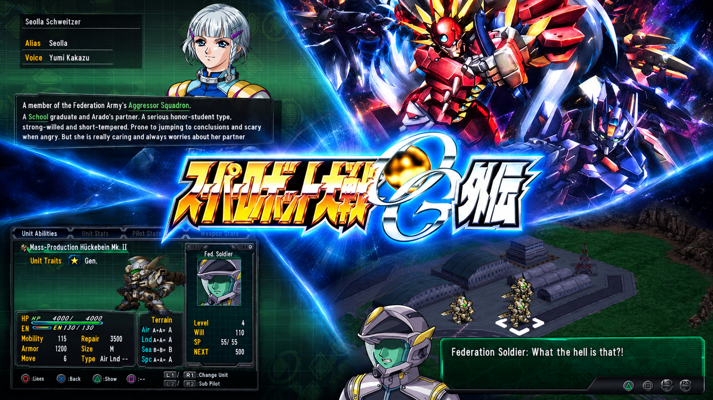

</p>

The goal is to make the game fully playable in English while preserving its story, character voices, terminology, menus, and original presentation. Names and attacks follow the official English localizations of *SRW OG1/OG2* wherever they exist, and everything is checked against the Japanese original.

**Download:** [RC01 pre-release](https://github.com/Nrlemo/Super-Robot-Wars-OG-Gaiden-English-Ver/releases/tag/RC01) · [All releases](https://github.com/Nrlemo/Super-Robot-Wars-OG-Gaiden-English-Ver/releases)

### We need your support! 💫

Every line of the game is translated and the game is playable from the title screen to the battle animations. We are looking for players to test this build on emulators and, above all, on **real PS2 hardware**. 💥

Grab your original Japanese ISO, follow the [installation steps](#installation) below, and help us polish this game! Please report any visual bugs 🐛 or text issues in the [Issues tab](https://github.com/Nrlemo/Super-Robot-Wars-OG-Gaiden-English-Ver/issues).

**AND CONSIDER SUPPORTING FURTHER DEVELOPMENT!**

<a href="https://www.buymeacoffee.com/Srwa_en" target="_blank"></a>

## Project status: RC01 (release candidate)

- ✅ **Everything is translated:** story script, battle quotes, database and Library, menus and system text, tutorial/help/Q&A, Shuffle Battler (cards, effects and messages), terrain and music labels, and the text baked into menu graphics and banners.
- ✅ **Validated on the PCSX2 emulator and on Open PS2 Loader (OPL).**
- ⏳ **Real PS2 hardware has not been tested yet.** Reports from physical consoles are very welcome.
- 🔎 **What RC01 is for:** checking that **no untranslated Japanese remains** anywhere in the game (menus, graphics, rarely-seen screens).
- 📝 **Still pending:** a complete proofreading pass over the script. It has only been partially validated, so expect the occasional awkward line or inconsistency.

## Screenshots

| | |
|---|---|
| 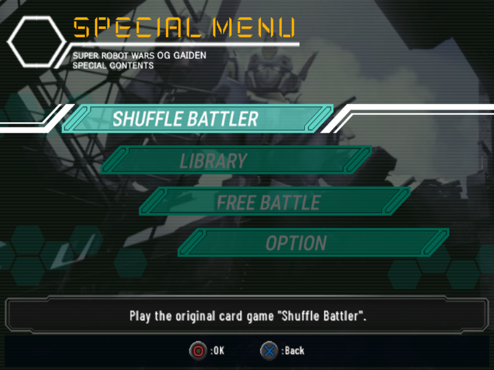<br><sub>Special Menu</sub> | 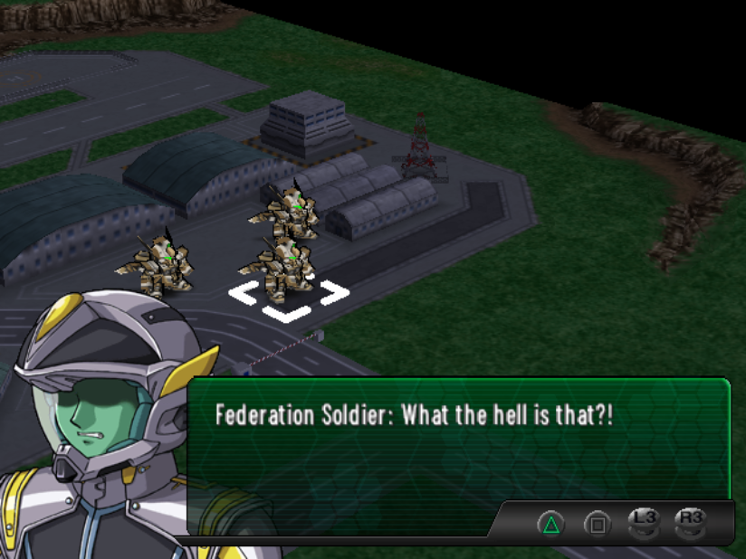<br><sub>Story dialogue</sub> |
| 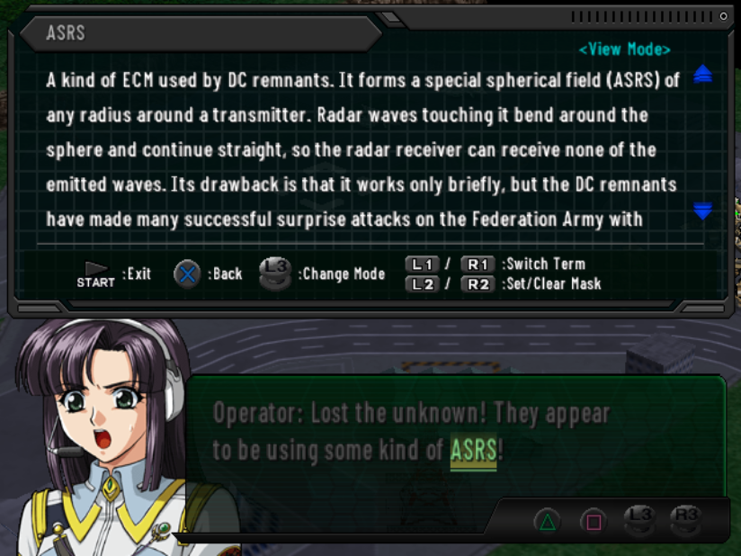<br><sub>Glossary term popup</sub> | 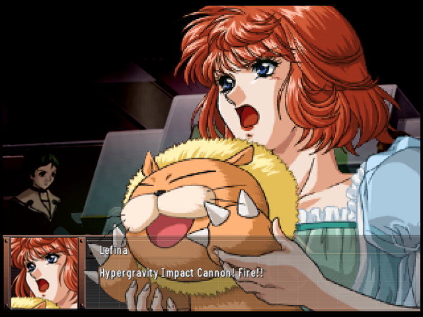<br><sub>Cutscene</sub> |
| 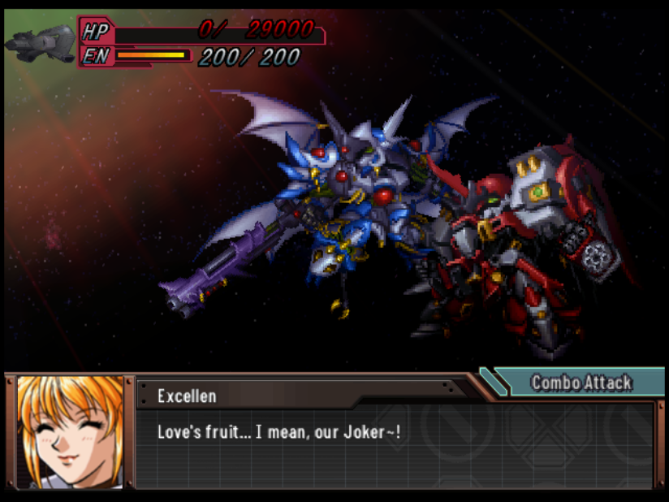<br><sub>Battle quotes</sub> | 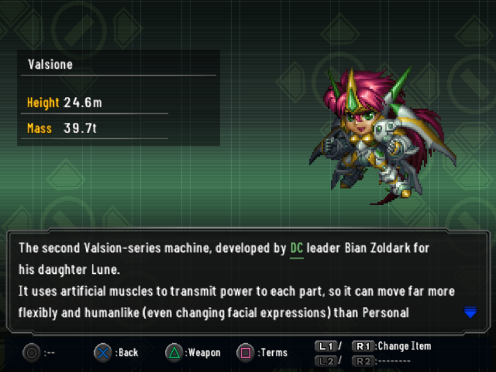<br><sub>Library</sub> |
| 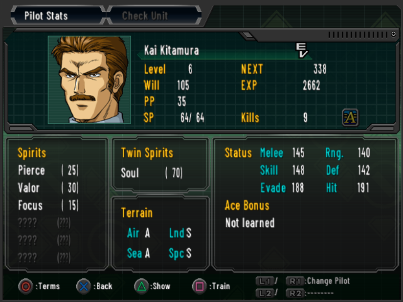<br><sub>Pilot Stats</sub> | 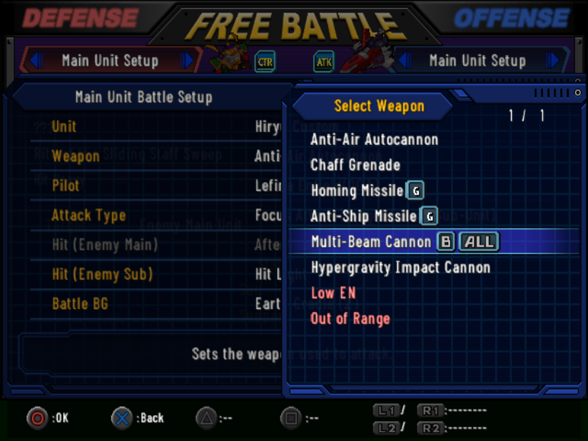<br><sub>Free Battle – weapon select</sub> |
| 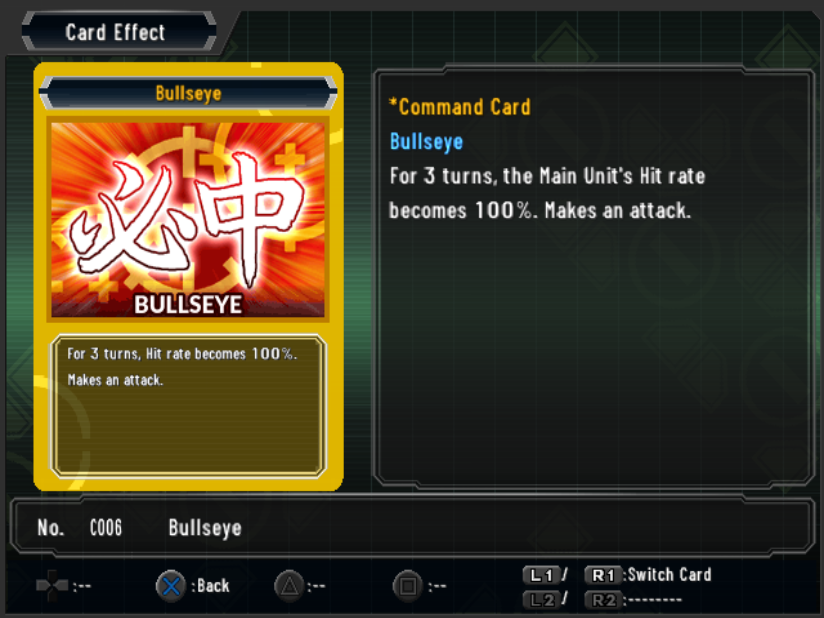<br><sub>Shuffle Battler card</sub> | 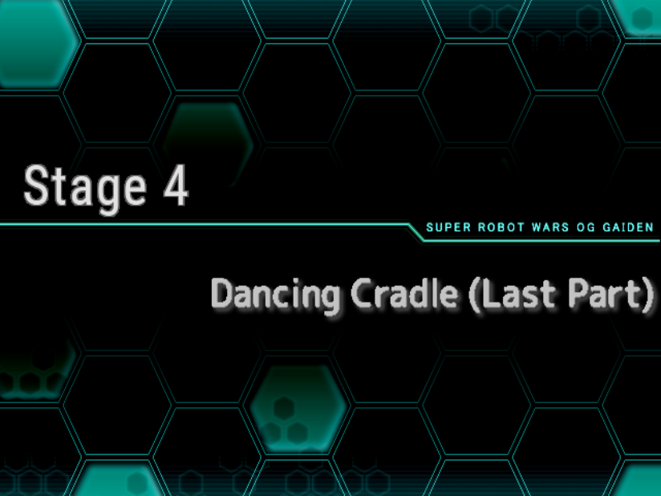<br><sub>Stage banner</sub> |
| 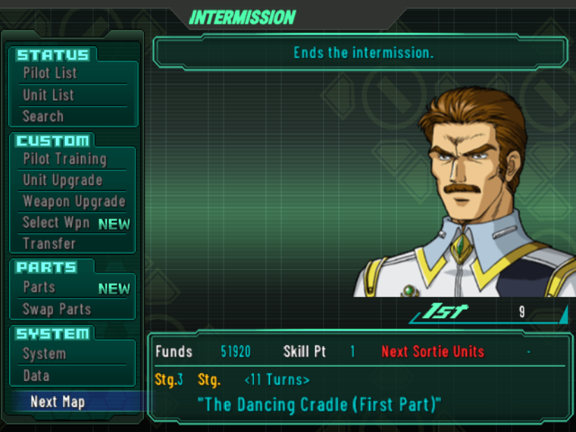<br><sub>Intermission</sub> | 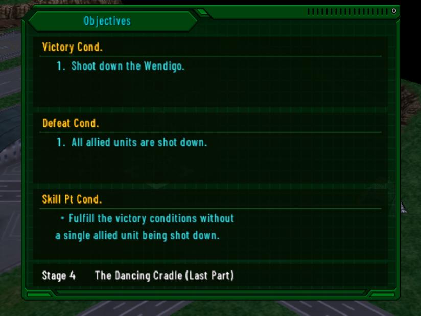<br><sub>Objectives</sub> |

**[📁 More screenshots (41) →](screenshots/gallery/)**

## Installation

You need **your own copy** of the Japanese game. No game image, BIOS, or game data is distributed here — only a patch file.

**1. Get the right base ISO**

*Super Robot Taisen OG Gaiden (Japan, Korea)*, SLPS-25836. Check that its MD5 is:

```
cb7dc4485f46f220c46095c966a3aad0
```

**2. Download the patch**

Download `SRWOGG_EN_RC01.xdelta` from the [RC01 release](https://github.com/Nrlemo/Super-Robot-Wars-OG-Gaiden-English-Ver/releases/tag/RC01).

**3. Apply the patch (xdelta)**

- **Windows / any browser:** use [Delta Patcher](https://www.romhacking.net/utilities/704/), [xdelta UI](https://www.romhacking.net/utilities/598/) or [Rom Patcher JS](https://www.marcrobledo.com/RomPatcher.js/). Choose the original ISO as the source file, `SRWOGG_EN_RC01.xdelta` as the patch, and save to a **new** file name.
- **Linux / macOS (command line):**

```sh
xdelta3 -d -s "Super Robot Taisen OG Gaiden (Japan, Korea).iso" SRWOGG_EN_RC01.xdelta SRWOGG_EN_RC01.iso
```

Your original ISO is never modified.

**4. Verify the result**

The patched ISO must have this MD5 (if not, the base ISO is not the expected dump):

```
7e834ed083969bc379b43cc2a57714d8
```

**5. Play**

- **PCSX2:** boot `SRWOGG_EN_RC01.iso` directly.
- **Open PS2 Loader (OPL):** copy the ISO to the `DVD` folder of your drive/USB/SMB share (rename it as OPL expects, e.g. `SLPS_258.36.Super Robot Taisen OG Gaiden.iso`).
- **Real disc:** burn the ISO as a PS2 DVD-ROM image.

> 💾 **Start a New Game.** Some text (objectives, save titles) is stored inside save data, so saves made with the Japanese game or earlier builds can show Japanese or garbled text.

## Known issues

- **#84 — Unit Stats:** the *HP* and *EN* labels appear twice (a text label plus the game's own sprite). Cosmetic; the Japanese game also draws both.

Found something else? Please [open an issue](https://github.com/Nrlemo/Super-Robot-Wars-OG-Gaiden-English-Ver/issues) with a screenshot.

## Reporting bugs and testing

Helpful details: what screen you were on, a screenshot, the **MD5 of your patched ISO**, and how you ran it (PCSX2 version / OPL / real console). Anything still in Japanese, cut-off text, text overlapping a value, or broken glyphs is worth reporting.

## FAQ

**The patched ISO has a different MD5.** The base ISO is probably a different dump (other region, headered image, or modified). Use the Japan/Korea release, SLPS-25836.

**Can I use the patch on a CD/other region?** No — the patch is made for that exact ISO.

**Is the translation final?** No. This is RC01: complete, but the script still needs a full proofreading pass.

## How does it work?

The original game stores text in several formats, and many labels live inside graphics. The project extracts everything into editable files, translates it in batches with a shared glossary, and fits it with a **variable-width font (VWF)** so English fits where Japanese characters had fixed cells. Tools validate every string against its box in pixels, rebuild the disc, and run automated emulator smoke tests. Details: [project status (Spanish)](docs/PROJECT_STATUS_ES.md).

## Tools and sources

**Tools used**

- [**Ghidra**](https://ghidra-sre.org/) with the Emotion Engine (MIPS R5900) processor plugin — static analysis of the game executable and overlays.
- [**PCSX2**](https://pcsx2.net/) — emulation, debugger, watchpoints and PINE IPC for automated smoke tests.
- [**ImHex**](https://imhex.werwolv.net/) — hex editing and format reverse-engineering.
- [**xdelta3**](https://github.com/jmacd/xdelta) — patch generation and verification.
- **Python 3** (with Pillow, segno, OpenCV) — extraction, reinsertion, font and texture tooling, pixel-level text-fit validation.
- [**Open PS2 Loader (OPL)**](https://github.com/ps2homebrew/Open-PS2-Loader) — testing on console-style loading.

**Sources and references**

- [**Akurasu Wiki**](https://akurasu.net/wiki/Super_Robot_Wars) (CC BY 3.0) — *OG Gaiden* and *OGs* pilot, mech, weapon, parts and skill databases, used to build the project glossary.
- The [Japanese *OG Gaiden* strategy wiki on atwiki](https://w.atwiki.jp/srwoggaidenkouryaku/pages/1.html) — Japanese-language reference.
- The official English localizations of *Super Robot Wars OG1/OG2* — canon for names, terminology and attack names, always checked against the Japanese original.

## Project scope and rights

This is an unofficial, non-commercial fan translation. It is not affiliated with or endorsed by Banpresto, Bandai Namco, or the original rights holders. No game disc image or console BIOS is provided; use only game data from a copy you are legally entitled to use. All trademarks and copyrighted material belong to their respective owners. The contents of this repository are licensed under the [GPL-3.0](LICENSE).

<a href="https://www.buymeacoffee.com/Srwa_en" target="_blank"></a>
